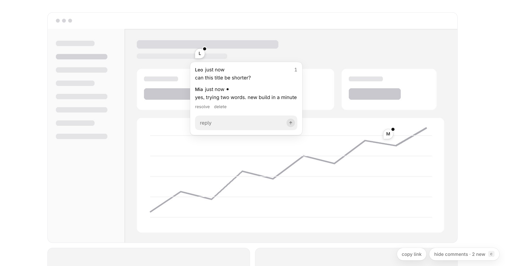
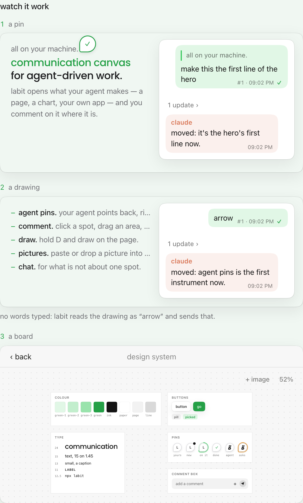
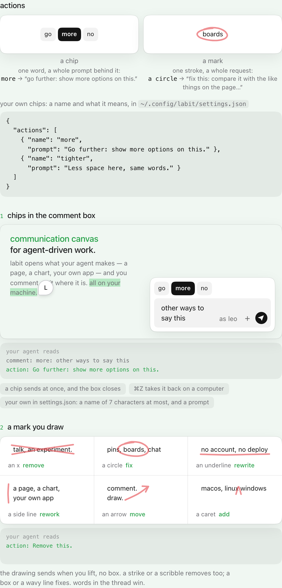
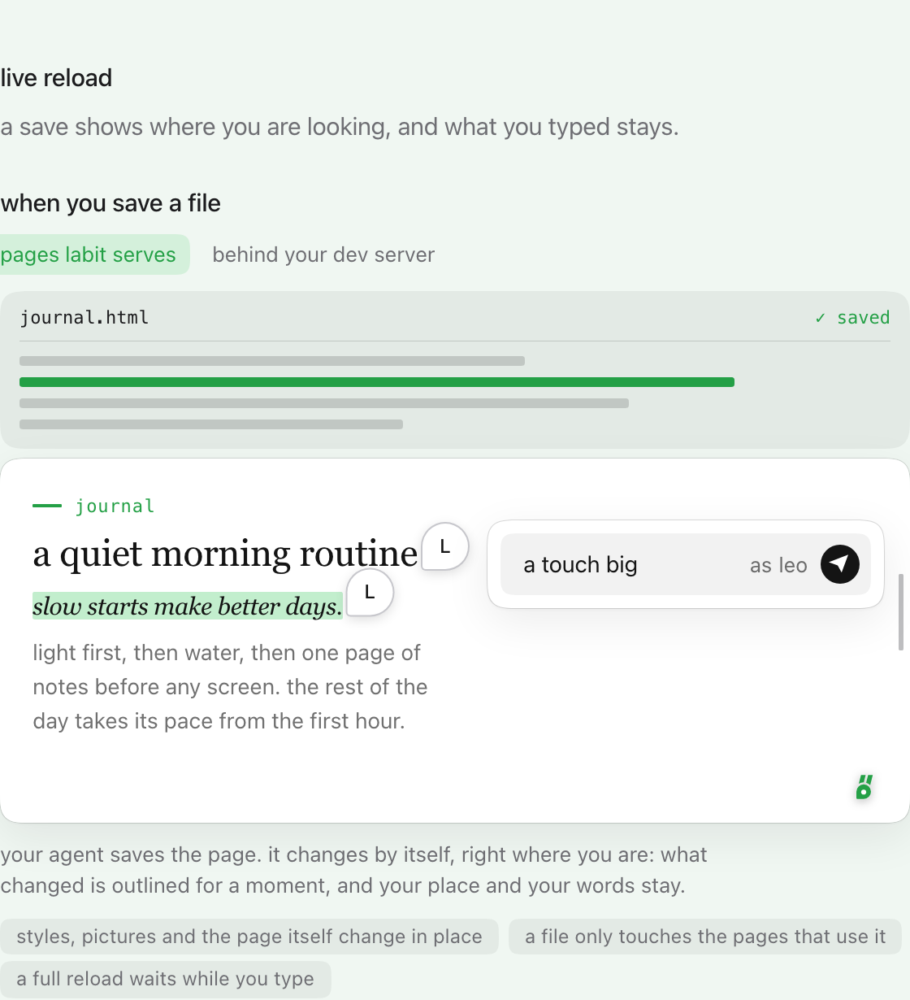
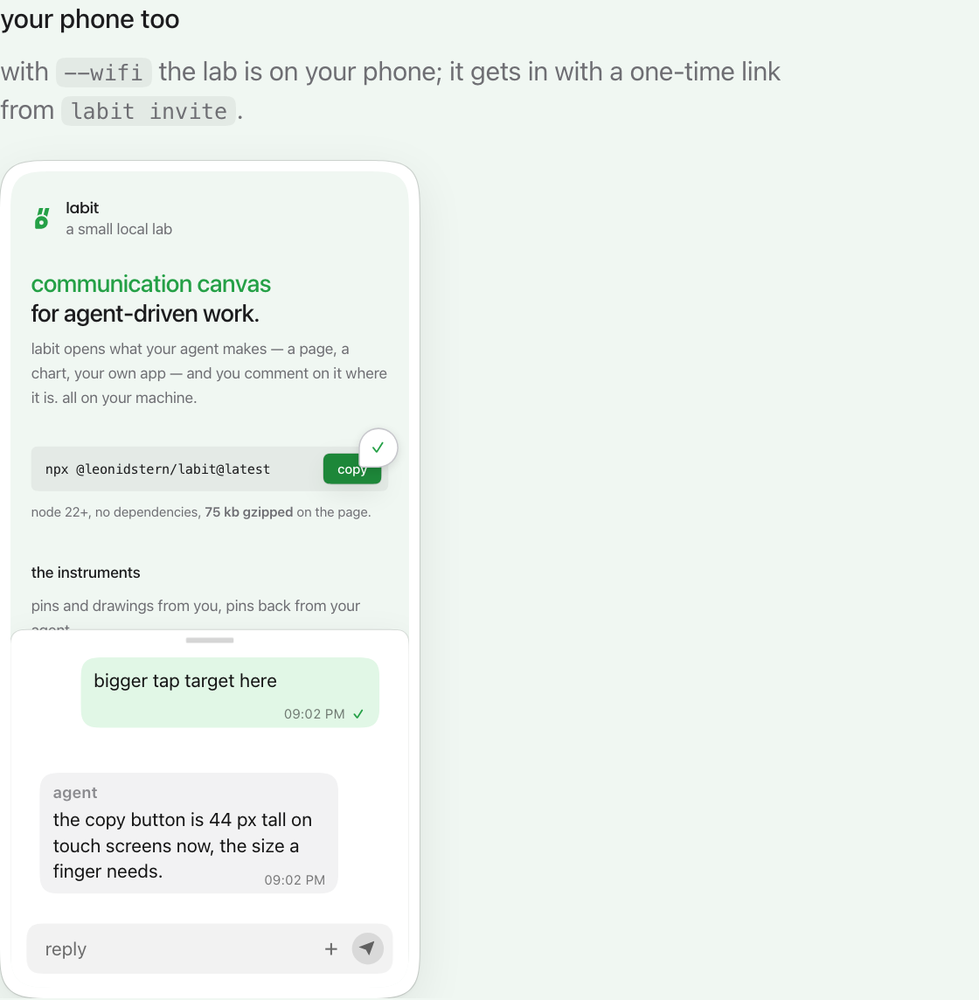
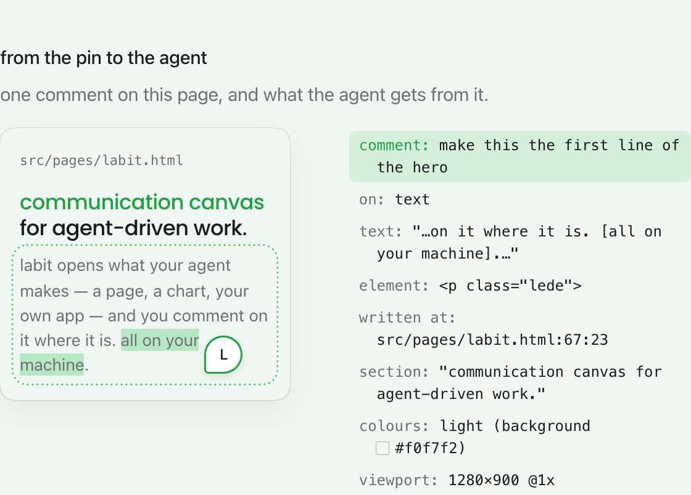
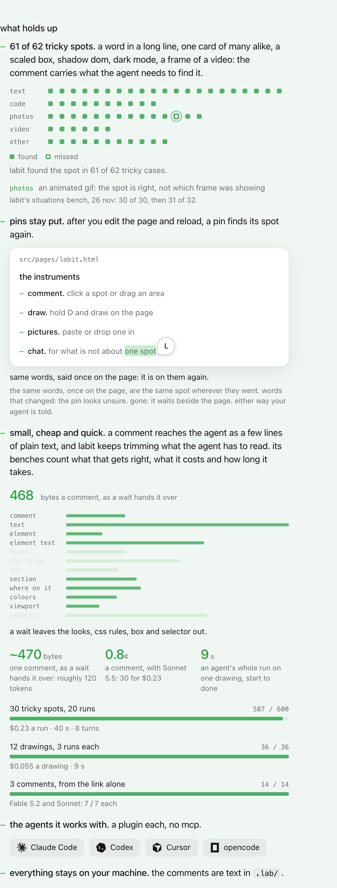

<h1><picture><source media="(prefers-color-scheme: dark)" srcset="docs/labit-mark-dark.svg"></picture> labit</h1>

[](https://www.npmjs.com/package/@leonidstern/labit) [](https://github.com/leonidstern/labit/actions/workflows/test.yml) [](LICENSE)

**Communication canvas for agent-driven work.** labit opens what your agent makes — a page, a chart, your own app — and you comment on it where it is. Your coding agent reads the comment, changes the code, and answers on the pin. All on your machine.



## Start

In your project:

```sh
npx @leonidstern/labit@latest
```

It serves your HTML pages itself, or sits in front of your app's running dev server (Astro, Next, Vite…), and opens the page with comments on top. Click to comment, drag to mark an area, hold `D` and drag to draw on it (circle, arrow, underline, cross out), Shift-drag to quote words. `M` hides the comments.

## What you can do

- **Pin a spot.** Click a spot, drag an area, or Shift-drag to quote words. Your agent gets the words, the element, the section and the colours around them, and answers on the pin with a live status line while it works.
- **Draw it.** Hold `D` and draw: a circle fixes, an X removes, an underline rewrites, an arrow moves, a caret adds. The drawing is sent when you lift; no words needed.
- **Tap an action.** Chips in the comment box (`go`, `more`, `no`) send a whole prompt in one word. Add your own in `~/.config/labit/settings.json`:

  ```json
  { "actions": [{ "name": "tighter", "prompt": "Less space here, same words." }] }
  ```

- **Boards.** Pages and pictures side by side on one canvas: variants to pick from, a design system to zoom into.
- **Live reload.** Save a file and the open page changes in place; your scroll and a half-typed comment stay. Behind your dev server, its own hot updates come through, and a full reload waits until you send what you're typing.
- **Your phone too.** `--wifi` puts the lab on your phone with a one-time link; comment there, your agent answers on both.
- **Motion.** `P` pauses everything that moves on the page, `S` plays it at ¼ speed, and a pin on a loop or video keeps its moment.

<picture><source media="(prefers-color-scheme: dark)" srcset="docs/readme/watch-it-work-dark.png"></picture>

<picture><source media="(prefers-color-scheme: dark)" srcset="docs/readme/actions-dark.png"></picture>

<picture><source media="(prefers-color-scheme: dark)" srcset="docs/readme/live-reload-dark.png"></picture>

<picture><source media="(prefers-color-scheme: dark)" srcset="docs/readme/phone-dark.png"></picture>

<picture><source media="(prefers-color-scheme: dark)" srcset="docs/readme/pin-to-agent-dark.png"></picture>

## How it works

1. **Install:** `npx @leonidstern/labit@latest` in your project.
2. **Open your page:** a page your agent made, or your app behind its dev server.
3. **Comment:** click a spot or draw. Your agent answers on the pin.

## What holds up

- **61 of 62 tricky spots** (a word in a long line, one card of many alike, a scaled box, shadow DOM, dark mode, a video frame): the comment carries what the agent needs to find it ([bench/](bench), 26 Nov 2026).
- **About 470 bytes a comment**, roughly 120 tokens, as `wait` hands it over; **about $0.008 a comment** with Sonnet in the bench (30 for $0.23, 23 Nov 2026).
- **Pins stay put** after you edit the page and reload: they find their words again.

<picture><source media="(prefers-color-scheme: dark)" srcset="docs/readme/what-holds-up-dark.png"></picture>

## Let your agent answer

**Claude Code:** install the plugin once, then say **"start labit"** in any project.

```text
/plugin marketplace add leonidstern/labit
/plugin install labit@leonidstern
```

The plugin also wakes Claude for pins it missed: if you comment while it is busy building, or its `wait` lapsed, the pin comes in as its next turn the moment the current one ends, from any folder.

**Codex:** add the marketplace, install labit from it, and trust its hooks once with `/hooks`.

```sh
codex plugin marketplace add leonidstern/labit
```

**Cursor:** install labit from the repository as a plugin (it carries the skill and the hooks).

**opencode** (2.x): one file, in your project (or `~/.config/opencode/plugins/` for every project), and the skill from the CLI:

```sh
mkdir -p .opencode/plugins && curl -fsSL https://raw.githubusercontent.com/leonidstern/labit/main/hooks/agent.mjs -o .opencode/plugins/labit.js
```

Each gives your agent the skill and two hooks, with no MCP: pins it works on show a live activity line, and a pin it missed comes in as its next turn (Codex can't be woken while idle). Without the hooks the agent still answers with `wait` and `reply`, as below.

**Any other agent:** tell it to run these in your project.

```sh
npx @leonidstern/labit@latest wait                    # ends with your next comment
npx @leonidstern/labit@latest reply <id> --done "…"   # answers on the pin and closes it
npx @leonidstern/labit@latest reply <id> --progress "…"  # during long work: one line next to its name, replaced by the next
npx @leonidstern/labit@latest pin <selector> "1. …"   # its own pin on a spot: suggestions and questions, one per point, numbered
```

Run each `wait` from the agent itself, never in a shell loop (`while true; do … wait; done`): a loop keeps listening after its session is gone, so pins are handed to nobody. A pin handed over that gets no reply of any kind in 2 minutes (`LAB_ANSWER_MS`) is marked "not answered" and goes to the next wait, and the pill says "Claude isn't answering" until that session replies.


**Fewer permission prompts (Claude Code):** copy [examples/claude-settings.json](examples/claude-settings.json) to `.claude/settings.json` in your project (or merge its `permissions` into yours). labit's commands then run without asking; `--wifi` and `invite`, which let another device in, still ask. Claude Code reads a project's allow rules only once you've opened the folder in it and trusted it.

## Comments on your deployed sites (colabit)

A lab for the people you work with, on your own Vercel: one address, a path per person, pins and threads on every page, no agent. One click to deploy and one command per person: [co/README.md](co/README.md).

## Good to know

- `--wifi` lets your phone comment too (`labit invite` turns it on in a running lab by itself, same address and pins; `labit --no-wifi` turns it off). Each device opens a one-time link from `npx @leonidstern/labit@latest invite`, so being on the same wifi isn't enough. The pages still travel in the clear over the wifi.
- Agents learn how you like answers: reply as usual, and when you say an answer was too long or unclear, your message shows **rule?**. Tap it and the rule goes to `~/.config/labit/replies.md`, handed to every agent with your pins.
- You name yourself once. The name is kept for this computer in `~/.config/labit/settings.json`, so every later lab starts out knowing you — browsers keep it per port, labs don't. `labit invite [name]` carries a name to a phone the same way. `--page /path` makes the link open that page. Opening a used or old link again on a phone that's already in just takes you there, and a phone that keeps using the lab stays in.
- Settings (port, your dev server, keys, the quick-action buttons of the comment box, how long the lab waits…): `labit.json` in the project and `~/.config/labit/settings.json` for you (the `actions` list is set only there, not on the page). `labit settings` shows them all; [docs/settings.md](docs/settings.md) explains each.
- Signing in through the lab: an app whose sign-in sends you back to an allowed address (OAuth, "Sign in with…") only knows the dev server's port, so the round trip from the lab's port fails. Sign in on the dev server's own address first (`localhost:3000`): browsers share cookies across ports on `localhost`, so the lab's page is signed in too. Or add the lab's address (`http://localhost:4400/…`) to the app's allowed callback URLs.
- Git Bash on Windows turns `--page /spot/trade` into `C:/Program Files/Git/spot/trade`; labit stops and says so. Write the page without its first slash (`--page spot/trade`), or set `MSYS_NO_PATHCONV=1`.
- A pin on a React, Vue, Next or Astro dev page also names the component that drew it and, where the framework tells, its file and line, never a guess.
- Comments stay in `.lab/` in your project. Add it to `.gitignore`. `labit gc` lists every lab folder you have used, its `.lab` size and what could go; it only reports.
- A click on the page pins a comment; the page's own links and buttons keep their clicks. Hold ⌥ to pin on anything, controls included.
- No dependencies, Node 22+. `--help` lists everything else.

## License

[PolyForm Small Business 1.0.0](LICENSE). labit is free for people and companies with fewer than 100 people and under $1M in yearly revenue: use it, change it and ship it inside your own work. Larger companies need a paid license from the author. That makes labit source-available, not OSI open source. Versions already on npm (0.6.2 and earlier) stay under MIT.

Made by [leonidstern](https://github.com/LeonidStern) · [OOZE](https://ooze.design)
