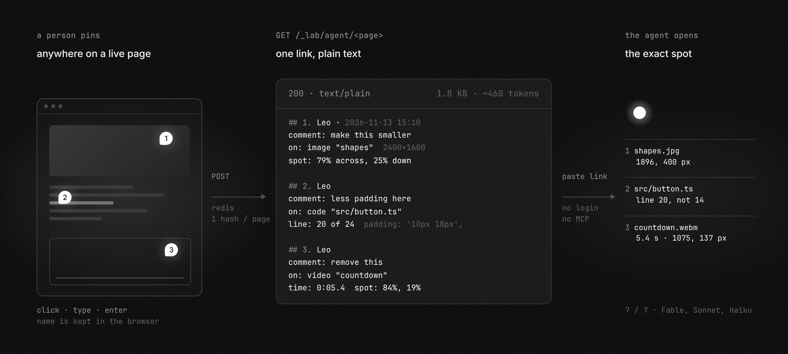

# Agent readability benchmark

Can an agent find what a comment points at, from the link alone? One test page (`site/`) has a photo, a code file and a video. Three comments are pinned the way a person would: on the red circle, on `padding` in line 20 of `src/button.ts` (line 14 has the same text), and on the red box in the video at 5.4 s.

```
node bench/run.mjs                      # pins the comments, checks the agent link (needs playwright)
ARTIFACT_URL=<link> node bench/run.mjs  # also runs the same checks on a shared Claude artifact of the same page
node bench/score-agent.mjs <answer.json> # scores an agent's answer
```

## Results, 2026-11-13

**What the link gives an agent** (`run.mjs`, 8 checks: file, spot in original pixels, code line, video second)

| | lab agent link | shared artifact link |
|---|---|---|
| response | 1.8 KB plain text, ~460 tokens | 37 KB app shell |
| comments in it | 3 of 3 | 0 of 3 |
| checks passed | 8 / 8 | 0 / 8 |

The only text in the artifact response is "Claude Artifact Content is user-generated and unverified." The page and its comments load later, in a signed-in browser.

**Agents doing the work** (given the link and the repo, asked for file + line / pixel / second; `score-agent.mjs`)

| agent | lab link | artifact link (no login) |
|---|---|---|
| Claude Fable 5.2 | 7 / 7, all high confidence | 0 / 7: found 0 comments, "a 37 KB generic app shell" |
| Claude Sonnet | 7 / 7 | — |
| Claude Haiku | 7 / 7 | — |



All three found the red circle at 1896,400 of 2400×1600, line 20 (not 14), and the red box at 5.4 s, 1075,137 of 1280×720. Answers are in `results/`.

The benchmark also caught a gap: comments on code used to record only the nearby words, so an agent couldn't tell line 14 from line 20. They now record the line, its number and the block's label.

## Situations: 30 kinds of comment

`run.mjs` checks three comments. `situations.mjs` pins 30, each a different kind of thing a person points at, on a small made-up site in `situations/` (pricing, docs, tour, demo and status pages with their code, data, pictures and videos):

| group | situations |
|---|---|
| text (9) | one word · a heading · a list item · a link (Option-click) · a table cell · an area over three words of a line · an area over two lines · a form field · a sentence that is on the page twice |
| code (5) | a line far down a long block · the second of two identical lines · the same line in two files · inline code in a sentence · the same command in two blocks with no label |
| photos (7) | a spot in a big screenshot · an area · a cropped thumbnail (`object-fit: cover`) · a `srcset` image · an SVG shape · a CSS background · a row in a tall screenshot |
| video (3) | a spot at 7.3 s · almost the same place at 1.5 s · an area on a video with black bars |
| other (6) | empty space between sections · the sticky header · a phone layout · text put there by a script, far down · a canvas chart · dark mode |

```
export NODE_PATH=<a folder with playwright>/node_modules
node bench/situations.mjs                          # pins all 30, writes results/situations-agent-text.txt and situations-truth.json
node bench/score-situations.mjs <answer.json>      # scores an agent's answer: per situation, per group, total
node bench/situations-media.mjs                    # only to remake the pictures and videos in situations/media
```

An agent gets `situations-task.md`: the agent text and the files in `situations/`, nothing else. `situations.mjs` also checks, for each comment, that the agent text carries what is needed to find the spot. Where it does not, the situation stays in the set with an `expected_gap` in the truth, and the scorer lists it apart. Five today:

- **Empty space between sections**: the click lands on `<main>`; only "% down" of the whole page-tall element is printed.
- **CSS background photo**: the file is named, but there is no spot inside it.
- **`srcset` image**: the percentages are right, the size printed with them is the layout size (912×608), not the file's (1600×1067).
- **Row in a tall screenshot**: the spot is rounded to whole percent, 72 px of a 7200 px file, more than a 56 px row.
- **Dark mode**: nothing says which colours the person saw.

The code blocks in `situations/docs.html` are copies of the files in `situations/src` and `situations/config`; change both together.

## Situations, batch 2: 32 more

`situations.mjs --batch 2` pins 32 comments that batch 1 does not have, on seven more pages of the same made-up site (`situations/b2-*.html`: workspace, customers, members, docs, about, film, integrations). The situations are in `situations-2.mjs`.

| group | situations |
|---|---|
| text (12) | a label added by CSS (`::after`) · the “…” of a cut-off title · a 150-character address that wraps · a word in a `<details>` the person opened · a hint shown on hover · an item of a menu that opens on click · a `<select>` after picking an option · a word in a window over the page · a grid where CSS `order` moves a tile · Arabic (right to left) · Japanese (no spaces) · German words that come from `locales/de.json` |
| code (5) | an added line in a diff · a table with its own line numbers, showing lines 34–51 of a file · one element per line with `<br>` (Docusaurus) · a line below a folded function · the fold button itself |
| photos (7) | `<picture>` with another crop on the phone · a picture turned 8° · a PNG inside an inline SVG · slide 3 of 5 · an icon on a sprite sheet · an animated GIF · a picture that loads late |
| video (3) | a looping background video while it plays · a video playing at double speed · a video in a window over the page |
| other (5) | two pins a few pixels apart (2) · the ninth of twelve identical cards · text in a preview scaled to 60% · text inside a web component (shadow root) |

```
export NODE_PATH=<a folder with playwright>/node_modules
node bench/situations.mjs --batch 2                # pins all 32, writes results/situations-2-agent-text.txt and situations-2-truth.json
node bench/score-situations.mjs <answer.json>      # the batch is the one whose comments the answer holds (or: --batch 2)
node bench/situations-2-media.mjs                  # only to remake the b2-* pictures, the GIF and the video
node bench/situations-2-guide.mjs                  # only to remake situations/b2-guide.html after changing situations/src/calendar
SHOTS=<folder> node bench/situations.mjs --batch 2 # also saves a picture of the window after each pin, to check by eye
```

An agent gets `situations-2-task.md`. Ten of the 32 are expected gaps today (the widget and the API were not changed for them):

- **Label added by CSS** (`::after`): the pin is on the heading, with the heading's own text. The label is not in the text.
- **Menu item**: Option-click still runs the item. The menu closes, and the pin lands on the paragraph that was behind it.
- **`<select>`**: the chosen option is not recorded; the element text is every option in a row. (The pin is on the closed list: the open list is drawn by the system and was not tried.)
- **Japanese**: the word under the pin is taken up to the next space, so the whole sentence is quoted as the word.
- **Table with line numbers**: the text says “line 6 of 20” for the line the page numbers 38 (it counts line breaks in the table's markup). The selector still leads to the row.
- **One element per line** (Docusaurus): no newline characters, so the text says “line 1 of 1” and prints the start of the file. The block's title is not picked up. The selector still counts the line.
- **Turned picture**: the spot is worked out from the upright box around it: about 80 px off in a 1200 px file.
- **Picture inside an SVG**: recorded as “svg animation”, with the spot in whole percent of the SVG, not in the picture's pixels.
- **Animated GIF**: the spot is right, but nothing says which of its states was showing.
- **Web component**: the pin stops at the component; no words from inside its shadow root.

Two things could not be made into a situation, because no comment can be left there at all:

- **A native `<dialog>` opened with `showModal()`**: the comment box opens behind the dialog and cannot be typed in.
- **The control strip of a `<video controls>`** (about the lowest tenth): a click there never pins, with or without Option.

Two more things seen on the way: Option-click on any control also runs it (the fold button opens its fold, a menu item acts); and a click on the “…” of a cut-off title quotes a word from the hidden part.

The code blocks in `situations/b2-guide.html` are written by `situations-2-guide.mjs` from the files in `situations/src/calendar`.

## Cost per task

`cost.mjs` runs a task above through Claude Code several times per arm, each in a fresh copy, and records what each run spent and whether it was right. The numbers are the host's own: model calls, uncached input, cache-write and cache-read input, output tokens, turns, tool calls by kind, bytes of tool results, pictures opened, wall time and cost in USD at list price. A number the host doesn't report stays unknown, never zero. Runs of different arms are shuffled together.

```
node bench/cost.mjs situations --arms full,lean --runs 10 --model sonnet    # also situations-2
node bench/cost.mjs --summary bench/results/cost/<file>.json
```

Arms are what the agent is handed: `full`, the saved agent text, or `lean`, what a wait hands over (the lines in `LEAN_SKIP`, lib/comments-api.mjs, left out). Each arm gets the median and p90 of each number, a 95% interval for the mean cost, and the cost per run that got everything right (all runs' cost, the wrong ones too, over the right ones). The raw runs are in the same file, with the commit, the host's version and the model.

Read cost per right run first: text a run doesn't get can come back as files and pictures it opens instead.

### Results, 2026-11-23

Situations (batch 1), Sonnet 5.5, Claude Code 2.1.330, 20 runs per arm in two sets of 10, at ebc0f88 (`results/cost/`):

| arm | situations wrong | runs all right | mean cost (95%) | cost per all-right run | median turns | median cache read |
|---|---|---|---|---|---|---|
| full | 8 of 600 | 14 / 20 | $0.234 (0.224–0.244) | $0.334 | 8.5 | 392k |
| lean | 21 of 600 | 9 / 20 | $0.236 (0.220–0.252) | $0.525 | 7.5 | 340k |

The lean text is about 25% shorter and costs the same per run: more than 90% of the input is the conversation read again from cache on each call, and the pin text is about 2k tokens of it. It gets more wrong (Fisher's exact test, p ≈ 0.02). Of the misses the second set names, dark mode is 5 of 10 lean runs against 1 of 10 full ones: lean leaves out the `colours:` line, the only one that says the page was dark.

### Drawings and the skill, 2026-11-23

`node bench/cost.mjs drawings` runs each of the 12 drawings of `drawings/` on its own (run `drawings/draw.mjs` first), the text as a wait hands it over, Sonnet 5.5, 3 runs per drawing and arm (`results/cost/drawings-sonnet-2026-11-23-09-08.json`). Every arm got 36 of 36 right.

| arm | mean cost a run | median cache read |
|---|---|---|
| full: the drawing's text as a wait sends it | $0.056 | 119k |
| nolines: without the `lines` coordinates of a mark the page read | $0.057 | 119k |
| skill-whole: plus the whole skill | $0.068 | 138k |
| skill-core: plus the skill without its Boards and Artifact parts | $0.066 | 132k |

Leaving the coordinates out saves nothing on these marks (their `lines` are 47–188 characters). The skill adds about $0.01 a pin when the agent reads it with every pin; its core alone saves about $0.002 of that, within the spread.

### Typed pins and Artifact comments, 2026-11-23

The 12 asks of the drawings, typed with the same words (`drawings/typed.mjs`: "remove", "typo", "move this into the Team plan"…): as labit pins on the same elements as the drawings, and as comments a person left on a private Artifact of the same page, read with Claude's artifact comment tool (`drawings/artifact-comments.json`). The prompt is the same for both. Sonnet 5.5, 5 runs per ask and arm (`results/cost/drawings-sonnet-2026-11-23-09-22.json`):

| arm | right | mean cost a run | cost per right run |
|---|---|---|---|
| typed labit pins | 60 / 60 | $0.055 | $0.055 |
| Artifact comments | 51 / 60 | $0.059 | $0.069 |

The 9 misses are two comments whose Artifact anchor wasn't the element meant: "typo" on Team's "Unlimted history" was saved on Studio's "Unlimited history" (4 of 5 runs wrong), and "drop this line" on Studio's "Priority support" was saved on the Plans heading (5 of 5). The labit pins were made by a script at the exact elements and the Artifact comments by hand, so part of the gap may be where the clicks landed. The Artifact text also carries a fixed preamble of about 2.8 KB per read.

## The loop: marks, questions, pictures, long threads (bench/multi, 23 Nov, #425)

`bench/multi/run.mjs` makes the comments with the real widget (drawings, pins, a pasted picture, replies), hands an agent the page's agent text and a copy of the page, and has a second agent grade the diff and the answer. Ten cases: the four marks ones, a circle with a question, an arrow with a question, a picture-only pin, a long thread whose ask changed in its second message, a fix the person says is still wrong, and a pin made on a phone.

```
NODE_PATH=<folder with playwright-core>/node_modules node bench/multi/run.mjs sonnet 5
LAB_ROOT=<another checkout> TAG=before …   # the same cases with another version's text
CHECK=1 TAG=check …                        # the agent may look at the page (node shot.mjs <file> <width>)
```

Sonnet, 5 runs per case (results-loop-*.json, results-marks-fix.json):

| case | before #442 | after #442 | after, may look | several marks fix |
|---|---|---|---|---|
| arrow with "why does this look different?" | 1 / 5 (moved it 4×) | 5 / 5 | 3 / 5 (2 partial) | |
| circle with "what is this tag for?" | 5 / 5 | 5 / 5 | 3 / 5 (edited 2×) | |
| move this one, rename that (arrow + circle) | 2 / 5 | 2 / 5 | 3 / 5 | 10 / 10 |
| picture only, long thread, still wrong | 15 / 15 | 15 / 15 | 15 / 15 | |
| phone pin | 4 / 5 | 2 / 5 (also stacked .stats) | 4 / 5 | |
| all ten | 42 / 50, $3.16 | 43 / 50, $3.13 | 43 / 50, $3.65 | 20 / 20 marks cases |

- The drawing's action line issued as an order over a question made the agent move the button; since #442 it doesn't.
- With several marks in one drawing, the area's own "in the area: Alerts" line pulled "move this one" onto the wrong card. Leaving the area's contents out when each mark already says what it is on fixed it (10 of 10).
- Letting the agent look at the page cost 17% more and about 2 s per pin, and didn't make it more right here: the misses were readings of the ask, not how the page looked. It also nudged two answers to a question into edits. So looking stays optional, and a done answer says whether it was checked.
- The phone pin's misses are extra edits to other rows (.stats) that were squashed too; the grader counts them against "nothing else changes".
